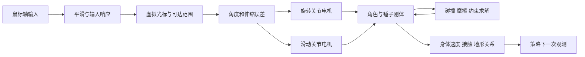

# 《掘地求升》物理机制、训练环境与速通算法调研

更新日期：2026-10-20。研究对象是 _Getting Over It with Bennett Foddy_ 原版游戏。研究目标是构建可复现的控制与评估环境，学会可靠通关，再在成功率约束下缩短通关时间。

## 1. 结论、证据与优先级

公开生态已经提供物理状态读取、实时输入、同步步进、状态恢复、局部搜索和分段学习的多条实现。最值得作为代码主线的是 `miwate/getting-over-it-rl`；最值得作为吞吐与几何表征参考的是 `Heuriz/goi-rl`。视觉项目、Linux 工具、关卡导入和 TAS 工具有各自用途，不能按项目名称混为同一能力水平。[^miwate] [^heuriz] [^vision] [^aiget]

在已核查材料中，尚无充分的独立复现证据证明学习型策略能够在原版游戏中从底部无读档稳定全程通关。miwate 报告的连续最佳进度约为 63%，并报告保存／恢复搜索已经找到通关路径；这两种结果的评估设置不同。其模型卡中的局部 8/8 通关也不构成从底部的成功率。该结论只覆盖已检索公开证据，不是“全球无人完成”的断言。[^miwate] [^hf]

更深入的源码检查得到三个需要优先解决的问题：

1. **恢复后的重复一致性与原轨迹连续性不同。** miwate 的客户端明确说明：恢复重建物理世界，因此未中断原轨迹与恢复后轨迹不要求相同。探索轨迹还记录恢复发生的位置，回放时重复这些恢复。不能把这种回放称作无读档连续执行。
2. **原版资源与控制器不保证原版时间演化完全不变。** 插件保留原控制器，但接管更新顺序、相机、传送、事件和终点判定；需要专门审计这些修改。
3. **公开模型还不是完整复现包。** 推理代码要求独立的观测归一化文件；检索时的模型文件列表未包含这些文件，抽查 ZIP 内也未包含。缺少它们可能显著改变策略输入。[^miwate-client] [^miwate-plugin] [^miwate-train]

### 1.1 证据标签

| 标签         | 含义                                   | 可作何种判断                         |
| ------------ | -------------------------------------- | ------------------------------------ |
| 源码事实     | 已阅读固定提交中的实现、常量和调用关系 | 判断程序写了什么，不证明运行结果     |
| 作者报告     | README、模型卡、作者说明或源码实验注释 | 作为有出处的进展线索，等待复测       |
| 官方机制说明 | 游戏创作者解释、Unity 官方 API 文档    | 支撑机制和接口语义；仍需匹配游戏版本 |
| 推导／建议   | 本报告的分析、实验规格和算法设计       | 不应当写成已验证成果                 |
| 待验证       | 未拿到必需资产，或需要运行游戏才能确定 | 后续实验清单的一部分                 |

未进行完整游戏训练、视频逐帧成绩认证、跨机器复现或性能测量。源码快照见 [manifest](sources/source-manifest.json)，逐文件保存上游永久链接和内容哈希。

### 1.2 资料排序

P0 表示在设计环境／算法前应阅读；P1 表示主线实现时使用；P2 表示扩展与历史参考。排序依据是对本研究目标的帮助，不是通用算法排名。

| 优先级 | 资料                                                                | 首要用途                                           |
| ------ | ------------------------------------------------------------------- | -------------------------------------------------- |
| P0     | Foddy 的 2019 年答复和 2026 年代码说明                              | 正确理解关节电机、虚拟光标、接触和控制器           |
| P0     | miwate 的 `Game.cs`、`Plugin.cs`、`client.py`、`env.py`             | 定义原版接入、动作语义、状态和恢复                 |
| P0     | miwate 的 `explore.py`、`plan.py`、`arrival_test.py`、`marathon.py` | 分清搜索成功、恢复回放、局部成功与连续成功         |
| P0     | 基础机制教程和保守通关路线                                          | 建立动作原语、关卡划分和失败分类                   |
| P0     | RLPD、逆向课程、RFCL、Go-Explore                                    | 解决难状态覆盖、成功数据利用和长程探索             |
| P1     | Heuriz 的数据管理、SAC 和 CUDA 雷达                                 | 几何特征、吞吐、异步数据问题                       |
| P1     | Linesight、TMRL                                                     | 借鉴速通／赛车任务的计时、轨迹、历史观测和实时接口 |
| P1     | 视觉版和 AIget                                                      | 根据操作系统、观测设定选择接入技术                 |
| P1     | 关卡导入与 TAS 工具                                                 | 局部课程、示范采集、地图泛化                       |
| P2     | DrQ-v2、TD-MPC2、DreamerV3                                          | 在环境和基线可靠后研究视觉／模型式方法             |
| P2     | Unity 复刻、旧存档工具和演示视频                                    | 教学、消融和历史背景                               |

完整可点击来源见 [资料索引](sources/资料索引.tsv) 和文末参考文献。

## 2. 相关项目的实际能力

### 2.1 代码与复现价值排序

| 排名 | 项目                                             | 已核实内容                                                                | 主要限制                                                 |
| ---- | ------------------------------------------------ | ------------------------------------------------------------------------- | -------------------------------------------------------- |
| 1    | miwate/getting-over-it-rl                        | C# 插件、Python 环境、PPO、课程、探索、规划、SAC 混合数据、评估和模型发布 | 归一化资产缺口；修改后的环境需忠实度验证；成绩未独立复测 |
| 2    | Heuriz/goi-rl                                    | UDP、160 维观测、SAC、CUDA 雷达、批量角色数据                             | 未附游戏侧 C#；未附可核实成绩和模型                      |
| 3    | Residualcanliu/goi-vision-rl                     | DXCam、SendInput、Gymnasium、CNN-PPO、CameraLogger 源码与上游 DLL         | 单环境实时采样；作者称评估未测试；仍处早期               |
| 4    | shush-collab/AI-plays-getting-over-it            | Linux 状态探测、输入、窗口、重启与存档重置工具和测试                      | README 明确说明不是完整 RL 项目                          |
| 5    | AadityaH24/Reinforment-Learning-on-Climbing-Game | Unity ML-Agents、PPO／SAC 配置、相关 ONNX 和实验日志                      | 复刻物理和动作不同于原版；不能直接比较成绩               |
| 6    | Jor02/GOILevelImporter                           | BepInEx 地图导入、Unity 工具包                                            | WIP；需游戏／模组版本适配                                |
| 7    | GiantBooley/GOI-Modpack-Level-Importer-TAS       | 状态保存、时间缩放和回放操作                                              | 2026-07-09 归档；不能当学习型策略                        |
| 8    | rossning92/getting-0ver-it                       | Unity 复刻，亦是上述 ML-Agents 项目的基础                                 | 物理等价性未证明                                         |
| 9    | pfgithub/goilevelmod                             | 地图编辑、起终点和关卡编码                                                | 面向较老的游戏构建                                       |
| 10   | Skippeh/Oxide.GettingOverIt                      | 游戏模组扩展源码                                                          | 老接口，新增训练环境优先评估 BepInEx 路线                |
| 11   | wtdcode/SavingOverIt                             | 存档保存／载入工具                                                        | 普通存档不是完整求解器快照                               |

项目定位及限制来源于仓库说明与源码；上述排序为本报告判断。[^miwate] [^heuriz] [^vision] [^aiget] [^aaditya] [^importer] [^tas] [^clone] [^levelmod] [^oxide] [^saving]

`nuxlear/GettingOverIt` 的公开树基本只有 `.gitignore`；`rishavbhurtel/getting-over-it` 主要是截图、鼠标代码及学习计划；`animatemesh/GettingOvertItAIv1` 是浏览器游戏与地图编辑工程，未核实到学习型控制实验。`Skippeh/goi-modding-api` 的公开主树主要是说明和 Harmony 子模块。它们不进入优先复现名单。[^nuxlear] [^rishav] [^animate] [^modding-api]

### 2.2 miwate 的进展与证据缺口

GitHub 说明报告：从底部连续运行最佳约 63%；10 个游戏实例合计约 6,000 steps/s。吞吐是作者报告，必须重新记录硬件、动作重复次数、物理步数与是否渲染才能比较。Hugging Face 模型卡报告最佳路线位置 542/864、从桅杆约 745 起步 8/8 完成，以及 27 个 PPO 策略。发布的 `chain.json` 是进度阈值到模型及探索噪声的映射。[^miwate] [^hf]

GitHub 另列出每路段入口起步、20 次、每次最多 10 分钟的结果：

| 路段                                                               | 作者报告成功率             |
| ------------------------------------------------------------------ | -------------------------- |
| Coffee Rock                                                        | Solved，作者定义为至少 90% |
| Devil’s Chimney                                                    | 85%                        |
| Construction Wall                                                  | 65%                        |
| Slide Skip                                                         | 80%                        |
| Furniture Land                                                     | 65%                        |
| Orange Hell                                                        | 0%                         |
| Bell Tower、The Hat                                                | 各 25%                     |
| Anvil、Floating Platforms、Bucket、Mountain Climb、Satellite Climb | 各 0%                      |
| Space                                                              | 45%                        |

这些数字与模型卡中的桅杆起步 8/8 不是同一口径。缺少起点集合、模型哈希、噪声配置及逐局结果的对应关系，不能把它们拼成统一成功率，也不能用 0/20 推断该段在所有条件下绝对不可解。[^miwate] [^hf]

源码注释还有更细的实验线索：随机探索找到的轨迹精确回放可成功，但加入小动作噪声会失败；直接模仿某批随机轨迹效果很差；部分策略自身的成功轨迹更容易被学习。这些是作者实验记录，不是本报告复现实验。其意义在于提醒：**轨迹可搜索到、可带恢复回放、可被闭环策略稳定实现，是三个不同目标。**[^miwate-explore] [^miwate-plan]

### 2.3 发布资产审计

本地 `sources/hf-model-api.json` 固定了抓取时的模型提交和文件列表，`hf-checkpoint-inspection.json` 记录了对 `ice-a-m33-a.zip` 的检查。检查只读取 ZIP 目录和 JSON，未反序列化模型对象。

`scripts/train.py` 的 `Player` 在模型之外加载 `vecnormalize_path(checkpoint)` 对应的 pickle。公开列表未附这类归一化文件，抽查 ZIP 只含标准 SB3 模型文件。因此后续应取得准确的归一化统计与模型配套信息，不能用零均值、单位方差或另训统计冒充复现。[^miwate-train]

还应核查：训练用示范 `.npz`、真实抵达状态、完整策略链启动命令、观察字段版本、插件构建、游戏版本和完整评估日志。论文式比较必须使用固定资产，不应边训练边挑模型再在同一测试集合报告最好结果。

## 3. 原版物理机制：从鼠标到接触动力学

### 3.1 结构与证据边界

Foddy 在 2019 年给出的最小结构是：旋转关节连接锅／角色与不可见刚体，再通过滑动关节连接锤子；两类关节电机负责定位。2026 年补充了根刚体、锅的有限转角、锤柄固定关节、视觉 IK 和调参过程。[^foddy-steam] [^foddy-reddit]

可用于理解的结构图如下。它是对解释和接口代码的概括，不是已经从本机游戏导出的精确层级图。



视觉逆向运动学不应被当作驱动人物的唯一机制。也不应假定游戏先判断“是否落地”，再切换成两套人工运动规则。创作者解释主要运动由两个关节电机与物理约束产生；某些接触状态仍用于摩擦、声音和其他脚本逻辑，必须检查实际版本。[^foddy-reddit] [^miwate-game]

### 3.2 创作者公开片段中的非线性

2026 年公开的 `FixedUpdate` 片段比“简单 PD 控制”这一口头概括更复杂，且不是当前 Steam 所有版本的完整源码。报告中的常数只描述该片段，不能未经测量固化为环境真值。[^foddy-reddit]

| 片段中的行为                                         | 对算法与建模的影响                       |
| ---------------------------------------------------- | ---------------------------------------- |
| 对鼠标速度量进行历史平均                             | 当前相同输入可能因历史不同而产生不同效果 |
| 虚拟光标位置限制在角色周围半径 3.5                   | 动作不是世界坐标中的任意锤头目标         |
| 光标存在向锤头回落的修正项                           | 零输入不等于刚性固定锤子                 |
| 角误差使用线性／平方量的非线性变换和死区             | 输入响应不适合直接假定为线性 PD          |
| 旋转电机速度限制到 ±800                              | 饱和后进一步增加输入未必增加同等效果     |
| 伸缩电机使用误差乘其绝对值，且按方向点积的四次方调制 | 旋转与伸缩控制相互耦合                   |
| 伸缩速度限制到 ±50，系数涉及关节反作用扭矩           | 接触与负载会改变控制响应                 |

片段中角度差分项乘以 `0.00f`。因此不能仅凭作者说“PD”，就在复刻中任意添加非零 D 项并声称物理一致。公开片段也没有包含完整输入采样链、所有序列化参数和碰撞体数据。[^foddy-reddit]

### 3.3 最小状态并不是位置与高度

建议把真实动态状态视为下列量的组合：刚体位置、姿态、线／角速度；关节伸缩与角度、约束和电机状态；虚拟光标位置及输入平滑历史；接触／摩擦状态；动态物体状态；区域事件与传送标志。求解器还有不可直接读取的缓存状态。

同一锅位置可能对应锤头挂住、锤头腾空、身体高速下落等情况。只输入相机 Y 无法区分这些动作需求。即使输入锅与锤头位置，若缺少速度和历史，也未必满足马尔可夫假设。

对状态策略，可先使用物理读取与短动作历史；对视觉策略，需要帧历史或记忆网络来估计速度、接触和控制器历史。比较视觉与状态策略时应说明哪些信息是特权信息：内部路线样条、碰撞体雷达、接触标志和精确速度都不是截图直接提供的量。

### 3.4 必须从所用游戏构建实测的参数

| 类别 | 应导出的字段                                                 | 用途                     |
| ---- | ------------------------------------------------------------ | ------------------------ |
| 版本 | 游戏构建、Unity 版本、Mono／IL2CPP、插件哈希                 | 确保源码接口与运行时匹配 |
| 刚体 | 质量、惯量、质心、重力系数、阻尼、约束、睡眠和碰撞模式       | 分析接触、惯性和跳跃     |
| 关节 | 类型、连接体、锚点、转角／行程限制、最大力／扭矩、motorSpeed | 建立控制结构             |
| 碰撞 | 真实 Collider 形状、层和接触过滤、材质摩擦／弹性             | 区分视觉几何与碰撞几何   |
| 时间 | fixedDeltaTime、求解器迭代、动作保持步数、脚本顺序           | 保证动作和计时可比       |
| 控制 | 灵敏度、输入增益、trackpad 模式、平滑与死区                  | 保证动作空间一致         |
| 世界 | 帽子、桶等活动物体、重力区、蛇、湖、空间传送                 | 避免只建模人物的伪环境   |

miwate 的 `EngineDump.cs` 和 `ColliderOverlay.cs` 是可用起点，但导出结构是否覆盖全部字段需要检查。材质、地图和游戏程序集仍以自有安装为准；本资料包未包含游戏二进制或提取地图。[^miwate]

## 4. 训练环境的源码级对照

### 4.1 三条接入路线

| 路线                   | 代表项目      | 优势                                   | 研究代价                             |
| ---------------------- | ------------- | -------------------------------------- | ------------------------------------ |
| 原版插件同步步进       | miwate        | 动作与物理步数明确，可关闭渲染，可搜索 | 手动调度和事件修改需验证忠实度       |
| 游戏持续运行＋批量 UDP | Heuriz        | 批量推理与快速特征计算                 | 新旧帧识别、丢包、动作生效延迟需记录 |
| 桌面实时截图＋输入注入 | vision／AIget | 更接近普通玩家输入界面                 | 截图延迟、焦点、时序和吞吐难控制     |

建议先采用同步状态环境作为研究主线，并保留正常运行的影子评估环境。视觉与桌面实时控制是独立扩展，不要在首轮同时改变算法、物理调度和感知设定。

### 4.2 miwate 的动作、观测与时钟

源码事实：

- `GoiEnv` 动作为二维 `[-1,1]`，默认乘以 `MOUSE=12`，发送到插件。
- 插件用 Harmony 替换 Rewired 的 `mouseX/mouseY` 轴，调用原 `PlayerControl.FixedUpdate`；其他轴返回 0。不是直接写锅的速度或锤头位置。
- `K=4` 表示一次策略动作保持 4 个物理步。Python 注释和计时假设物理频率 120 Hz，因此默认策略频率为 30 Hz；C# 实际读取的是运行时 `Time.fixedDeltaTime`。
- `client.configure` 的默认雷达数量是 16，`GoiEnv` 默认是 32。讨论训练配置应以环境创建参数为准，不能混用两个默认值。
- 基础字段 63 维：23 个物理／控制／进度量，另有 20 个前方路线点的相对二维坐标。默认加 32 维锅位置雷达、8 维过去动作和 2 个辅助量，合计 **105 维**；可选锤头雷达继续增加维度。
- 蛇接触状态在通信尾部传输，但不属于基础观测向量；用于可选终止逻辑。[^miwate-client] [^miwate-env] [^miwate-game]

物理、策略、渲染和墙钟时间必须分开：

$$
\Delta t_a=K\Delta t_p,\qquad
f_a=\frac{1}{K\Delta t_p},\qquad
T_{\mathrm{sim}}=\sum_t K_t\Delta t_p.
$$

其中 $\Delta t_p$ 为物理步长，$K_t$ 为动作保持的物理步数。若实测 $\Delta t_p=1/120$ 且固定 $K=4$，一次动作推进 $1/30$ 秒。训练加速改变墙钟耗时，不应改变模拟通关时间。

当前 `env.py`、`plan.py` 和 `marathon.py` 多处使用 120 或 30 的假设。更换 `K` 或游戏物理设置时，应统一从插件返回的实际时间配置计算，不能只改一个参数。物理步数、策略步数和采样率都应单独记录。

### 4.3 手动步进并非一次 Simulate 调用就完成

Unity 文档说明，手动 `Physics2D.Simulate` 不会自动调用 `FixedUpdate`，自动脚本更新也不因为关闭自动物理而自然停止。miwate 因此禁用相关脚本的自动执行，并按顺序调用锤子／锅摩擦更新、原控制器，然后推进物理。[^unity-sim] [^miwate-game]

其 `Step` 还处理起重机的模拟时钟运动、空间区域传送、相机跟随，以及动作结束后的姿态更新。若新环境重复运行自动 `FixedUpdate` 和手动控制器，或漏掉摩擦脚本，就可能训练出另一个动力系统。

### 4.4 原版忠实度审计

| 插件修改                             | 源码可见作用                          | 后续应验证                           |
| ------------------------------------ | ------------------------------------- | ------------------------------------ |
| 固定灵敏度与禁用 trackpad            | 统一训练输入                          | 与正常运行相同设置的动作响应是否一致 |
| 禁用相机自动更新并改由模拟步调用     | 适配加速、关闭渲染                    | 是否改变任何输入补偿或视觉观测       |
| 手动调度 PoseControl 并还原 hub 深度 | 避免视觉姿态写 Transform 扰动物理     | 与正常原版调度存在多大差异           |
| 关闭蝙蝠／礼物事件                   | 避免对象销毁破坏恢复                  | 相关碰撞体生命周期是否与原版一致     |
| 自行执行空间传送                     | 关闭渲染时仍可运行                    | 触发顺序、位置和速度是否一致         |
| 截获终点事件并设置 `Won`             | 防止片尾和存档写入，便于 episode 结束 | 判定是否早于或不同于正式通关事件     |
| 新建 PhysicsScene2D 恢复             | 清除旧接触缓存、固定创建顺序          | 恢复分布是否偏离未中断真实运行       |

这些修改有明确工程目的，但“使用原版地图和控制器”不等于“逐帧等价原版”。应分别报告：研究桥接环境成绩、正常时序的原版控制成绩；后者才适合与玩家通关时间讨论关系。不得直接把研究模组成绩当作社区排行榜合规成绩。[^miwate-plugin] [^miwate-game] [^rules]

### 4.5 Heuriz 的可借鉴点与数据风险

主入口使用 `claude_sac_policy.py`，32 维状态加 128 维 CUDA 雷达，二维动作默认缩放到 15，40 Hz 前台交互。并行角色数量来自注册表配置；不能把 40 Hz 说成固定 40 个角色。SAC 使用双 critic、目标网络、自动温度和 GPU 回放。[^heuriz]

默认回放容量为 $2^{20}$。按 160 维当前／下一状态、二维动作、一个 float32 奖励和一个 uint8 done 计算，原始张量约占 1.26 GiB；这是容量推算，不含模型、采样副本和 CUDA 分配器开销。

复现前检查：

- `old_timestamp` 在主循环中未更新，新帧条件可能重复接受同一帧。
- UDP 包格式正确不代表动作与观测对齐。需要加入 frame_id、action_id、物理步号，记录动作实际生效时刻。
- 使用最新一帧会跳过中间状态；跳过的模拟时间影响折扣、奖励积分和动作归因。
- 重置类型通过计时字段及低位编码区分，必须与缺失的 C# 发送端核对。
- `assets/related_seg_idxs.pt` 需预处理生成；主入口 CPU 回退不意味着 CUDA 雷达可在 CPU 运行。
- 全新目录创建和 checkpoint 文件名排序存在静态可见问题；不应直接无人值守长训。

CUDA 雷达按空间网格预筛选几何线段。应与 Unity 原生 raycast 对比：静态地形、动态帽子／桶、射线起点在碰撞体内、边界和遮挡。快的错误观测会让吞吐优势失去意义。

### 4.6 视觉和 Linux 路线

视觉版默认 10 Hz 动作、4×84×84 灰度帧、CNN-PPO，CameraLogger 提供相机位置奖励。上游包含插件源码和 DLL；本地快照仅保存源码。图像策略仍可能使用特权奖励，这需要和纯黑盒设置区分。相机坐标受跟随逻辑影响，不能未经标定视作人物世界高度。[^vision]

AIget 明确定位为 Linux 工具，含状态探测、输入、帧采集与重启检查。miwate 客户端直接导入 `msvcrt` 并使用 Windows API，插件工程引用 `GettingOverIt.exe` 和 Mono 程序集，因此不能在当前 Linux 工作区直接当作跨平台环境运行。若游戏构建为 IL2CPP，也不能直接复用需要 `Assembly-CSharp.dll` 的 Mono 接口。[^aiget] [^miwate-client]

## 5. 状态恢复、搜索与训练数据

### 5.1 三种确定性必须分开测试

| 性质           | 测试                                   | 为什么重要             |
| -------------- | -------------------------------------- | ---------------------- |
| 重复恢复一致性 | 同一快照恢复两次，执行同一动作序列     | 能否重复比较搜索候选   |
| 恢复连续性     | 未中断原分支 vs 从中途快照恢复后的分支 | 搜索路径能否无恢复执行 |
| 跨运行一致性   | 同构建不同进程／机器导入状态后比较     | 数据交换与结果复现     |

miwate 的 `client.py` smoke test 对前两项明确分开，且说明未中断原分支与恢复后分支不必相同。`marathon.py` 注释也记录长轨迹在另一次启动中重放可能漂移。因此 README 对“精确恢复”的概括必须按这些更细条件理解。[^miwate-client] [^miwate-marathon]

### 5.2 为何只保存位置和速度不够

miwate 保存各刚体的位置、旋转、速度、角速度、深度、完整 Transform 旋转、活动／睡眠状态、体类型；另存重力、模拟时间、关节电机、虚拟光标、平滑输入、接触集合、区域事件、传送标志和进度估计历史。恢复过程按固定层级次序重新创建物理对象，重建接触，再恢复脚本字段。[^miwate-game]

这能使“从同样的重建状态开始”更一致，但没有保存原求解器所有内部缓存。接触 warm-start、创建顺序、惯量重建与角度参考的微小变化，足以影响长时间高敏感运动。原始源码已经对这一点采取大量补偿，不应把一般的传送 API 当作同等能力。

Python 包装器也有状态：过去动作、stall 计数、最高进度、held_best，以及未来可能加入的 RNN 隐状态。当前 `GoiEnv.load_state` 会清零动作历史和部分计数，是“从该物理状态开始一个新尝试”，不是恢复整个策略交互过程。若做精确分支搜索，要分别定义 physical_state、wrapper_state、policy_state 三层快照。

### 5.3 现有搜索的具体实现

`explore.py` 明确使用 Go-Explore 思路：以路线进度的整数格与高度每 2 单位的格作为 cell；每格保留较短到达路径或首个状态。采样偏向探索次数少且接近前沿的 cell。随机鼠标笔划保持 8～24 个策略步，其中包含零输入。达到目标还要求锅或锤头有接触。[^miwate-explore]

两点不能忽略：

1. cell 只按进度与高度分箱，可能把“稳定挂住”和“高速坠落”合并。后续可加入速度、接触模式、锤头相对位置，以及动作鲁棒性或到达时间的 Pareto 集。
2. 输出轨迹包含 `cuts`，即保存状态恢复的分段位置。作者回放会在同样位置执行恢复，不能作为无读档路径证明。

`plan.py` 使用游戏本体作分支模拟器，滚动搜索候选轨迹，执行最优候选前几步后再规划。可选对候选加入动作噪声重测，并混合策略自行访问的状态以减轻模仿分布偏移。这是训练专家或有搜索预算的控制器，不能与只运行一次网络推理的策略共用评估标签。[^miwate-plan]

### 5.4 建议的数据格式

每个 transition 至少记录：游戏构建与插件哈希、env_id、episode_id、frame_id、action_id、物理步号、实际 $\Delta t$、观测版本、归一化版本、原始观测、原始／实际执行动作、奖励分量、terminated、truncated、重置原因、最终有效观测、路线阶段、空中／接触进度、模拟／墙钟时间。

每条演示另存：来源（人类／搜索／策略）、快照格式、恢复切点、是否经过无恢复重放、动作扰动成功率、正常时序通过情况和生成成本。不要把不同保真等级的数据混入“成功演示”而不加标签。

正常人类视频通常没有精确鼠标轴输入、物理状态与时间同步，适合路线理解，但不能直接充当带动作标签的数据集。需要另行同步录制输入和观测，或明确采用无动作视频学习方法。

## 6. 进度、奖励和 episode 定义

### 6.1 三种进度量

| 进度量                 | 优点                       | 缺陷                                                   |
| ---------------------- | -------------------------- | ------------------------------------------------------ |
| 世界高度／相机高度     | 简单                       | 水平绕行和必要下降难表达；原地跳跃可刷分；相机另有动态 |
| 原版路线样条投影       | 能描述主路线               | 相邻但隔障碍的样条段会造成跳变                         |
| 实际成功路径的局部弧长 | 允许先退后进，约束局部邻域 | 依赖参考路径；可能抑制速通捷径，仍有相位歧义           |

miwate 的 `Progress` 给样条前跳加入连续性约束；`goi_env/route.py` 则提供按真实爬升轨迹局部匹配的弧长进度。后者注释明确提到铁砧下绕行、桶的摆动、冰坡和桅杆前下降。它是帮助通关的课程／奖励工具，不应永久把策略锁在某条慢路线。[^miwate-game] [^miwate-route]

### 6.2 已有奖励与静态问题

Heuriz 将进度差负向截断到 −0.2，加入向上速度、锤子冲量与身体速度投影、向下冲量惩罚和动作范数惩罚；胜负覆盖为 ±20。非对称奖励能降低早期探索难度，但要检查原地周期运动的净回报。只根据公式不能断言已有策略一定利用了漏洞。[^heuriz]

miwate 默认奖励刷新最高进度，支持恢复奖励、退步惩罚和额外速度／腾空系数。`held_records` 只在锅或锤子接触物体时兑现新进度。源码测试区分了“空中飞高后落回原处”和“在高处挂住／落地”的奖励。[^miwate-env]

接触不等于稳定：短暂擦碰仍可能立刻坠落。建议训练早期可使用接触进度，评估时要求在目标区域持续一段时间或成功进入下一段，并明确这些门槛是提出的协议，不是上游成绩口径。

### 6.3 势函数塑形的正确形式

若希望在不改变原任务最优策略的理论条件下加入进度引导，使用与折扣一致的势函数差，而不直接把任意非对称进度奖励称为“策略不变塑形”。[^shaping]

$$
r'_t=r_t+\beta\bigl(\gamma\Phi(s_{t+1})-\Phi(s_t)\bigr).
$$

其折扣和满足

$$
\sum_{t=0}^{T-1}\gamma^t\bigl(\gamma\Phi(s_{t+1})-\Phi(s_t)\bigr)
=-\Phi(s_0)+\gamma^T\Phi(s_T).
$$

中间势项相消。终止状态势为零、终止处理与折扣一致，并满足相应 MDP 条件时，才可据此讨论策略不变性。若势依赖历史最高进度或路线指针，应把这些变量纳入状态。变时长动作应使用对应的 $\gamma_t$，不能在改变动作频率后照搬每步折扣。

miwate 注释中恢复／退步系数均为 1 时，奖励代数上等于普通进度差。这并不自动赋予它在 $\gamma<1$ 下的策略不变保证；本报告不把该源码注释当作理论证明。

### 6.4 终止与截断

原版全程评估应允许一般跌落与重新攀爬。湖、正式终点等可定义真实终止；把蛇接触、掉出局部窗口或卡住定义为训练终止，是课程便利，不可直接延续成“全程能力”评估条件。

对外加训练时间上限导致的截断，价值学习一般应从真实最后观测自举；对终止则不自举。若任务本身定义为有限时域，则剩余时间属于状态，到达任务时限可为真正终止；不能把所有 timeout 一概当成同一种情况：

$$
y_t=r_t+\gamma_t(1-\mathrm{terminated}_t)V(s_{t+1}).
$$

不能把 reset 后的新观测当成终止前的 next observation。若环境没有提供最后观测，应修复接口或明确舍弃该 transition。变时间间隔和跳帧数据还必须使用一致的累计奖励与折扣。[^gym-time]

## 7. 从通关到速通：目标与比较条件

### 7.1 明确三种能力声明

1. **研究桥接环境策略**：可以读取物理状态和路线；测试时不恢复、不分支搜索；物理按接口推进。
2. **正常时序原版策略**：不在评估期间重建物理场景，按实际输入链和正常时钟连续运行；记录推理延迟及实际动作。
3. **带规划／TAS 的控制系统**：允许模拟分支、保存／恢复或预录动作；单独报告规划成本和辅助条件。

人类排行榜有平台、模组和操作规则。旧规则帖是历史证据，不是当前完整规则；若以后要提交或宣称破纪录，需要读取当时生效规则并取得适用类别确认。本文提出研究评估协议，不承诺自动控制成绩会被人类榜接受。[^rules] [^rules-news]

### 7.2 不只优化成功轨迹的最好时间

建议先以成功率为主指标，再以满足成功率门槛的耗时为目标：

$$
\min_\pi\ \mathbb{E}[T\mid S=1],
\qquad \text{subject to } P_\pi(S=1)\ge p_{\min}.
$$

这里 $S$ 为固定时间预算内通关，$T$ 为通关模拟时间。建议开发门槛例如 $p_{\min}=0.9$，但这是待采用的研究规格，不是任务已达水平。只报告成功局耗时会忽略失败策略，因此必须同时报告成功率、预算内未完成比例、截尾耗时和所有评估局数。

对“多次重新开始直到成功”的体验，可另报期望总耗时。若每次尝试独立同分布、成功概率为 $p>0$，每次耗时为 $D$，且失败后的重启成本已计入，则

$$
E_{\mathrm{total}}=\mathbb E[D]+(1-p)E_{\mathrm{total}}
\quad\Longrightarrow\quad
E_{\mathrm{total}}=\frac{\mathbb E[D]}{p}.
$$

这是重复尝试目标，不是一次无重启通关耗时，也不适用于未明确设置重启规则的连续评估。

### 7.3 计时和折扣设计

每步时间成本应按秒计，例如 $r_t^{\mathrm{time}}=-\lambda_t\Delta t_a$。成功奖励、失败代价和塑形系数应固定并报告。不能为了快而鼓励策略在失败时尽早结束，以逃避时间惩罚。

折扣最好按真实模拟时域解释：

$$
\gamma=\exp(-\Delta t_a/\tau).
$$

例如默认 30 Hz 时，$\gamma=0.99$ 的指数时间常数约 3.32 秒，$\gamma=0.995$ 约 6.65 秒，$\gamma=0.998$ 约 16.65 秒。这些是数学推算，不表示策略只能看到这么长；它们说明长任务通常仍需要局部价值、课程或层次结构来传播远期成功信号。

改变动作频率时按同一个 $\tau$ 换算折扣，并按秒缩放时间成本；若使用动作时长策略，采用半马尔可夫式的变时长折扣和奖励累计。不要把更短动作步带来的计数差异误认为算法改进。

### 7.4 评估报告最小集合

| 维度   | 应报告内容                                             |
| ------ | ------------------------------------------------------ |
| 成功   | 全程成功数／总局数、置信区间、时间预算                 |
| 速度   | 成功局中位数、分位数、最好值；模拟时间与墙钟时间分开   |
| 稳定   | 大跌落次数、恢复耗时、卡住时间、各段首次通过时间       |
| 局部   | 标准入口、自然抵达状态、扰动状态三种分布               |
| 资源   | 全部在线／搜索交互步数、物理步数、训练和规划墙钟、硬件 |
| 可复现 | 代码／插件／模型哈希、归一化、切换规则、随机种子与噪声 |
| 证据   | 连续录像、逐步动作与时间戳、终点事件、恢复／搜索计数   |

开发期可以每配置少量种子和约 20 次评估筛选；最终候选建议 3～5 个独立训练种子、每候选至少 100 次预先固定的评估。这是预算允许时的建议，不是必须先做大规模扫参。零失败也不证明成功率为 100%，应报告置信区间。

## 8. 算法候选与建议主线

### 8.1 优先方案：成功数据＋起点课程＋闭环强化学习

建议从 SAC／RLPD 与 PPO 两个基线出发，以成功轨迹和自然抵达状态构造课程。初期使用特权物理观测，先解决控制，再研究视觉。RLPD 官方工作提供离线／在线数据混合利用的方法；逆向课程与 RFCL 提供逐步把起点移回真实初始分布的思路；Go-Explore 则直接针对记住有用状态、返回并继续探索。[^sac] [^ppo] [^rlpd] [^reverse] [^rfcl] [^go-explore]

具体研究步骤：

1. 通过人类或搜索采集少量局部成功轨迹，同时保存失败轨迹及来源。
2. 将演示分为“依赖恢复”和“无恢复可执行”；用后者或经扰动复测的前者构造训练起点。
3. 先从目标附近学习，再按验证成功率把起点向前扩展；同时保留一定比例底部起步和自然抵达状态。
4. 混合在线与离线数据训练，监控每段真实通过率、循环奖励和跌落恢复。
5. 在不恢复的连续运行中发现薄弱环节，回收实际失败前状态补训。
6. 全程可靠后再提高时间成本、优化路段切换和捷径，最后考虑蒸馏为更统一的策略。

单纯把 PPO 换 SAC 无法修复错误的环境、进度或数据分布；但离策略方法能使用策略本身未到达过的成功 transition，这对稀少的困难落地有实际意义。miwate 已有 RLPD 风格实现，适合从可比较改进开始，不能把整套组合当作未经检索的新算法。

### 8.2 先做哪些消融

| 对照                           | 固定项                           | 回答的问题                 |
| ------------------------------ | -------------------------------- | -------------------------- |
| PPO vs SAC                     | 观测、动作、训练预算、奖励、起点 | 基础算法差异               |
| SAC vs SAC＋离线数据           | 同一在线预算，另报离线生成成本   | 成功数据是否有效           |
| 固定起点 vs 逆向／前向课程     | 相同算法与奖励                   | 起点覆盖是否是主要瓶颈     |
| 空中最高进度 vs 接触／稳定通过 | 同一训练设定                     | 是否消除虚假进步           |
| 人工入口 vs 自然抵达起点训练   | 相同训练量                       | 策略衔接失败是否减少       |
| 无锤头雷达 vs 有锤头雷达       | 同一网络预算或明确参数差异       | 细接触几何信息是否重要     |
| 单策略条件化 vs 多个路段策略   | 相同总样本预算                   | 是否改善衔接或产生遗忘     |
| 固定动作保持 vs 可变动作保持   | 相同模拟时域折扣与资源统计       | 是否改善快速动作和精细落点 |

消融分阶段实施，一次改变一个主要因素。先选择一两个明确失败的路段，避免在全程任务上盲目扫所有组合。

### 8.3 鲁棒规划与专家迭代

游戏本体分支模拟可作为专家产生动作，但规划候选不能只按单次最大进度排序。建议按稳定通过、动作／状态扰动后的成功率和耗时共同筛选。之后用 DAgger 类的数据聚合，补充学生实际访问状态上的专家动作，降低仅模仿专家分布的误差。[^dagger] [^miwate-plan]

优先研究的问题是：对搜索找到的动作片段进行鲁棒筛选，能否比直接模仿更快得到可连续执行的策略？需比较相同总搜索和训练预算，不能把昂贵搜索成本隐去。

若测试时也运行规划，必须报告每次决策的分支数、规划步数、恢复次数与延迟。训练时使用搜索、测试时只运行策略，是另一类设置。

### 8.4 层次控制与切换

初始可沿用路段专家，但切换条件应逐步由“仅看进度阈值”扩展到接触、速度、姿态和目标区域。跨段训练要加入前一策略真实抵达状态。下落后返回上一策略需要滞回和恢复策略，不能在阈值附近频繁切换。

若使用条件化单网络，输入目标路段或子目标，保留历史难点回放以避免遗忘。评估须覆盖自然到达、稍偏离路线、锤头未挂住和不同速度四类情况。最优速通路线可能跳过传统路段，固定关卡切分应是课程工具，不是永久限制。

### 8.5 视觉与世界模型的安排

纯视觉可先比较 CNN-PPO 与 DrQ-v2。可研究特权 critic／状态教师到视觉学生的训练，但要明确部署时学生实际使用的输入，避免把隐藏状态泄漏到视觉成绩。[^drq]

TD-MPC2 和 DreamerV3 适合后续探索样本效率、记忆和规划。接触的短时不连续性、动态摩擦和长程误差会增加模型学习难度；先检查模型能否预测碰撞、挂住与跌落，再追求全程想象。没有本游戏实验不能声称它们会优于 SAC。[^tdmpc] [^dreamer]

### 8.6 跨游戏速通的高价值参考

Linesight 的价值是完整游戏接口、轨迹／参考线、历史动作、输入回放和速通记录组织。其 README 报告在 Trackmania 的人类水平与纪录成绩，属于另一游戏的作者报告。GOI 源码已经借鉴了前方路线点和动作历史，但汽车离散控制不能原样移植为锤子连续控制。[^linesight]

TMRL 提供实时 Gymnasium、SAC／REDQ、异步采样训练和图像／雷达路线，适合参考真实延迟处理与分布式训练。它在 Trackmania 中的雷达可来自屏幕；Heuriz 的雷达来自地图几何，二者信息条件不同。[^tmrl]

## 9. 游戏资料与任务分解

### 9.1 阅读顺序

1. 创作者物理解释：把输入、虚拟光标、电机、接触四层分开。
2. 基础操作机制教程：整理推起、挂住、摆动、撑杆式跳跃、绕障、落地等行为。
3. 保守的完整路线教程：确认每段的可达区域和稳妥落点。
4. 针对烟囱、橙子坡、帽子、铁砧、桶与冰坡的专题：为失败状态定义局部测试。
5. 速通录像与高级技巧：研究捷径和高风险动作，保留与稳妥路线的成功率对比。
6. TAS、Modpack 与关卡编辑：用于实验工具和演示，不把辅助通关算成策略能力。[^mechanics] [^ten-min] [^guides] [^resources]

世界纪录用于衡量最终速度上限，不适合作为第一阶段训练演示的唯一来源。高手轨迹可能具有极小容错；初期更需要宽容落点和可恢复轨迹。排行榜是动态页面，本报告不把某次抓取的纪录写成长期实验基准。[^leaderboard]

### 9.2 路段与控制难点的工作假设

下表用于组织实验，不是对游戏每一段的唯一官方分类；需结合实际录像与状态轨迹校正。

| 区域类型       | 关键控制问题                 | 建议采集                           |
| -------------- | ---------------------------- | ---------------------------------- |
| 起始岩石与树   | 推起、挂点、基础动作探索     | 输入—光标—身体响应，成功与原地摆动 |
| 烟囱与狭窄障碍 | 双侧接触、姿态限制、卡住恢复 | 接触集合、角速度、脱困时间         |
| 家具与建筑     | 组合动作、绕行与落点         | 下一落点、路线相位、失败前状态     |
| 橙子坡与帽子   | 摩擦、滑落、移动物体         | 静／动态接触、物体状态、重试分布   |
| 铁砧与平台     | 大动作后的精确挂住／落地     | 空中峰值、稳定通过、扰动成功率     |
| 桶与冰坡       | 动态支撑、先退后进、长跌落   | 支撑体运动、恢复路径、路线歧义     |
| 桅杆与空间     | 区域事件、重力／传送、终点   | 区域标志、实际终点事件和计时       |

### 9.3 视频证据的边界

El Maikini Dev 的 2023 年视频说明包含在 Unity 重建游戏、训练和结果章节，适合教学直觉；未在这里认证其逐帧表现，也不能转述为原版通关。茹莺主页与系列来自关联仓库引用，视频列表访问受限，未逐集核实。[^video] [^bili]

部分“AI 攻破最难游戏”的内容实际讲 QWOP。例如林亦 2026 年 7 月视频说明把《掘地求升》写成后续挑战。检索时应排除这种同作者、不同游戏的误归类。[^qwop-video]

## 10. 可执行研究路线与验收条件

### 阶段 A：固定环境与原版差异

交付：游戏／Unity／插件版本清单、控制图、引擎状态导出、碰撞体叠图、时间配置、输入响应报告。

实验：零输入保持；水平／竖直小输入脉冲；大输入饱和；锤头支撑；身体接触；帽子／桶交互；不同渲染状态；区域传送与终点。

验收：每一步动作推进量明确；原版与桥接的主要差异可解释；没有静默丢帧、双重物理推进或错误终点。容差应在选定版本上测量后固定，不预先声称逐位一致。

### 阶段 B：恢复和数据链路

交付：三层快照规范、恢复误差报告、源状态／分支／回放对比、完整 transition 格式。

实验：在腾空、支撑、滑动、动态物体与区域边界各选多个状态；分别做重复恢复、连续性和跨进程测试。记录首个分歧步和状态误差，而不仅是最后位置。

验收：搜索的数据标签能明确说明是否依赖恢复；物理状态与包装器／策略状态不混淆；失败能追到具体 frame_id。

### 阶段 C：局部基线

交付：一段容易区域和一段瓶颈区域的 PPO、SAC 基线；相同观测、预算和评价条件。

实验：先检查 reward hacking 和时序，再比较算法。记录真实落地、通过率、速度和失败原因；不只画 episode reward。

验收：固定入口与自然抵达集合均有结果，模型与归一化能从新进程加载；日志支持完整重现配置。

### 阶段 D：课程、数据利用与全程衔接

交付：搜索／示范数据、来源标签、课程调度、RLPD 对照和连续运行报告。

实验：离线数据、逆向课程、真实抵达状态补训分别消融；合计计算全部生成成本。保留旧难点状态，监控遗忘。

验收：从底部无恢复执行得到可复测提升；人工起点成功没有被冒充成全程进步。

### 阶段 E：速通优化

交付：成功率—耗时曲线、时间成本与路线选择消融、动作时长实验、正常时序验证。

实验：在固定成功率要求下优化局部耗时和跨段速度；比较稳妥路线与捷径；用从未参与课程调度的评估状态验证。

验收：速度提升不是减少成功率、提前判终点、增加恢复或漏算规划时间造成的。

### 阶段 F：论文级结果与发布

交付：代码／环境版本、模型／归一化、少量可分享的演示与元数据、评估种子、完整录像和逐步日志；不分发无权分发的原版游戏资产。

候选贡献应限定为可验证的问题，例如自然抵达分布课程、恢复感知的鲁棒示范利用、带接触信息的技能衔接，或在成功率约束下的速通优化。组合现成算法并不自动构成新方法，需要与最接近的课程／模仿／层次控制工作比较。

## 11. 后续研究必须先回答的问题

1. 最终目标是特权状态速通、视觉速通，还是要求正常原版时序的桌面操作？
2. 游戏具体构建和系统是什么；是否能安装 Mono BepInEx，还是需要 IL2CPP 路线？
3. 训练允许恢复、搜索与路线样条吗；测试明确禁止哪些辅助？
4. miwate 对应模型的归一化、示范和评估状态是否能获取？
5. 正常运行与桥接状态分布差异有多大；哪些修改影响最终时间？
6. 主要失败是无法到达、无法挂住、落地失败，还是落地后衔接失败？
7. 预算首先受 CPU 游戏实例、GPU 学习、通信还是窗口渲染限制？
8. 有多少高质量轨迹能无恢复执行并通过动作扰动测试？

这些问题不妨碍先阅读和构建测量工具，但决定了以后成绩的定义。建议第一轮只完成阶段 A、B 和两个局部基线，再据数据选算法方向。

## 12. 来源与快照说明

本地源码目录是选取的文本文件，不是完整 checkout。原版地图 CSV、游戏 DLL、模型权重和 Unity 二进制资产未放入资料包。来源清单保留固定 commit 和每个文件的 SHA-256；如需正式开发，应从上游获取完整代码，并固定版本、核对许可和依赖。

相较前两轮口头调研，本报告补充或收紧了以下判断：恢复不等于原轨迹连续；miwate 的 Go-Explore 风格实现可由源码直接确认，但完整路径可能依赖 `cuts`；游戏原版接入仍修改调度与事件；相机高度不是完整状态；进度差并不自动满足折扣势函数塑形条件。

### 12.1 按顺序阅读的本地源码

下面直接链接本地固定快照。重点看符号与调用关系；上游文本中的安装路径、实验次数和结论仍按作者报告理解。

| 顺序 | 本地文件                                                            | 定位符号／问题                                                  |
| ---- | ------------------------------------------------------------------- | --------------------------------------------------------------- |
| 1    | [Plugin.cs](sources/code/miwate/plugin/Plugin.cs)                   | `VirtualMouse`、`Patches`；输入替换、终点与事件修改             |
| 2    | [Game.cs](sources/code/miwate/plugin/Game.cs)                       | `TrySetup`、`Step`；原控制器与物理执行顺序                      |
| 3    | [EngineDump.cs](sources/code/miwate/plugin/EngineDump.cs)           | 导出的刚体、关节和物理配置是否足够                              |
| 4    | [Server.cs](sources/code/miwate/plugin/Server.cs)                   | TCP 协议、命令处理、渲染与步进                                  |
| 5    | [client.py](sources/code/miwate/goi_env/client.py)                  | `OBS_FIELDS`、`configure`、`_smoke_test`；观测布局与恢复连续性  |
| 6    | [env.py](sources/code/miwate/goi_env/env.py)                        | `step`、`load_state`、`progress_reward`；包装器历史、奖励与终止 |
| 7    | [route.py](sources/code/miwate/goi_env/route.py)                    | 实际轨迹进度、局部搜索窗口与捷径限制                            |
| 8    | [train.py](sources/code/miwate/scripts/train.py)                    | 起点课程、`Player`、`chain`、归一化及噪声                       |
| 9    | [explore.py](sources/code/miwate/scripts/explore.py)                | archive cell、采样权重、`cuts`                                  |
| 10   | [plan.py](sources/code/miwate/scripts/plan.py)                      | 候选评分、扰动重评、专家／学生状态分布                          |
| 11   | [rlpd.py](sources/code/miwate/scripts/rlpd.py)                      | `MixedBuffer`、PPO actor 初始化、critic warmup                  |
| 12   | [arrival_test.py](sources/code/miwate/scripts/arrival_test.py)      | 自然抵达状态评估                                                |
| 13   | [marathon.py](sources/code/miwate/scripts/marathon.py)              | 全程与区域模式的区别、计时假设、状态导出                        |
| 14   | [my_data_manager.py](sources/code/heuriz/my_data_manager.py)        | 特征缩放、奖励分项、重置编码与 transition                       |
| 15   | [main_train.py](sources/code/heuriz/main_train.py)                  | 40 Hz 主循环、新帧判断和策略同步                                |
| 16   | [CUDA 雷达](sources/code/heuriz/lidar_gen_cuda/lidar_gen_kernel.cu) | 射线与线段、空间候选、动态物体变换                              |
| 17   | [视觉环境](sources/code/vision/src/environment/goi_env.py)          | 截图与动作顺序、相机奖励、重置                                  |
| 18   | [相机插件](sources/code/vision/plugins/CameraLogger.cs)             | 奖励读数来源与更新频率                                          |

### 12.2 第一轮物理测量方案

以下是建议测量，不是已执行实验：

| 测量         | 输入与初始条件                           | 记录                                       | 主要排查                   |
| ------------ | ---------------------------------------- | ------------------------------------------ | -------------------------- |
| 空载输入响应 | 固定起点，短水平／竖直脉冲，多个幅度     | 原始轴、滤波输入、光标、关节速度、锅速度   | 增益、平滑、饱和、动作单位 |
| 零输入衰减   | 先伸锤，再保持零输入                     | 光标相对锤头距离、电机、接触变化           | “保持”与“放松”的真实语义   |
| 静态支撑     | 同一台阶挂锤，多个起始姿态               | 锤头接触、反作用力／扭矩、身体漂移         | 摩擦和约束、稳定区域       |
| 发力与落地   | 同一支撑状态，输入幅度／持续时间网格     | 起跳速度、峰值、落点、落地后状态           | 最优发力并不等于最大输入   |
| 动态支撑     | 在桶／帽子附近重复相同输入               | 支撑体与人物状态、接触图                   | 只重置人物是否造成任务漂移 |
| 时钟对照     | 相同动作，渲染开关与不同运行负载         | 物理步数、控制器调用数、模拟时间、状态差异 | 帧率污染、双重推进         |
| 原版对照     | 尽量匹配起始状态与输入语义的正常时序运行 | 短时响应和接触事件；不强求长程逐位相同     | 桥接修改是否改变控制规律   |

先用短脉冲与局部响应识别差异，再研究长轨迹。长程误差增长只能表明系统敏感，不能单独定位具体参数错误。对每类状态保存成功与失败样本，避免只对容易的空中状态验证恢复。

### 12.3 Windows 原版接口启动草案

下列命令依据固定源码组织，**尚未在游戏机器执行**。在已有兼容原版安装、BepInEx 和 .NET 构建工具的 Windows 环境中使用；游戏目录、程序集和 Python 包是否满足约束必须先确认。`dotnet build` 的上游工程包含向 BepInEx 插件目录复制 DLL 的动作。

```powershell
git clone https://github.com/miwate/getting-over-it-rl.git goi-env-work
Set-Location goi-env-work
git checkout e3978643d1fb0fe4f84aacd256312ce4f72b453f

$env:GOI_GAME_DIR = "C:\Path\To\Getting Over It"
dotnet build plugin/GoiBridge.csproj "-p:GameDir=$env:GOI_GAME_DIR"

# 先只装环境依赖并测协议；不要首先启动长训练。
uv sync
uv run python -m goi_env.client --game-dir "$env:GOI_GAME_DIR"
uv run python scripts/determinism.py --game-dir "$env:GOI_GAME_DIR"
```

`determinism.py` 只比较从同一恢复状态重复执行，不能替代客户端中“未中断 vs 恢复”对照，更不能替代原版忠实度测试。通过环境测量后，再检查 `pyproject.toml`／锁文件中的训练依赖、安装训练 extra、查看各脚本 `--help`。本目录的源码快照有意不包含全部运行资产，不应直接在 `sources/code/` 中训练。

### 参考文献

[^miwate]: miwate. Getting Over It, played by reinforcement learning. 固定提交 `e3978643d1fb0fe4f84aacd256312ce4f72b453f`，检索 2026-10-20. [仓库](https://github.com/miwate/getting-over-it-rl/tree/e3978643d1fb0fe4f84aacd256312ce4f72b453f).

[^heuriz]: Heuriz. goi-rl. 固定提交 `a2f00cefabfbf6e64fc02789f00583a548219f0a`. [仓库](https://gitee.com/Heuriz/goi-rl/tree/a2f00cefabfbf6e64fc02789f00583a548219f0a).

[^vision]: Residualcanliu. goi-vision-rl. 固定提交 `6feb95e4e1792551fb04683efd6e4dce9299c78b`. [仓库](https://github.com/Residualcanliu/goi-vision-rl/tree/6feb95e4e1792551fb04683efd6e4dce9299c78b).

[^aiget]: shush-collab. AIget. [仓库](https://github.com/shush-collab/AI-plays-getting-over-it).

[^aaditya]: AadityaH24. Reinforcement Learning on a Climbing Game in Unity. [仓库](https://github.com/AadityaH24/Reinforment-Learning-on-Climbing-Game).

[^importer]: Jor02. GOILevelImporter. 固定提交 `6f579d35a287073e3e5a69d8912a39ed556cf85e`. [仓库](https://github.com/Jor02/GOILevelImporter/tree/6f579d35a287073e3e5a69d8912a39ed556cf85e).

[^tas]: GiantBooley. GOI Modpack Level Importer TAS，已归档. [仓库](https://github.com/GiantBooley/GOI-Modpack-Level-Importer-TAS).

[^clone]: rossning92. getting-0ver-it. [仓库](https://github.com/rossning92/getting-0ver-it).

[^levelmod]: pfgithub. Level Maker Mod. [仓库](https://github.com/pfgithub/goilevelmod).

[^oxide]: Skippeh. Oxide.GettingOverIt. [仓库](https://github.com/Skippeh/Oxide.GettingOverIt).

[^saving]: wtdcode. SavingOverIt. [仓库](https://github.com/wtdcode/SavingOverIt).

[^nuxlear]: nuxlear. GettingOverIt. [仓库](https://github.com/nuxlear/GettingOverIt).

[^rishav]: rishavbhurtel. getting-over-it. [仓库](https://github.com/rishavbhurtel/getting-over-it).

[^animate]: animatemesh. GettingOvertItAIv1. [仓库](https://github.com/animatemesh/GettingOvertItAIv1).

[^modding-api]: Skippeh. goi-modding-api. [仓库](https://github.com/Skippeh/goi-modding-api).

[^hf]: miiwater. PPO agents for Getting Over It，模型卡、权重与 chain.json. [模型页](https://huggingface.co/miiwater/goi-rl). 本地原始响应见 `sources/hf-model-api.json`。

[^foddy-steam]: Bennett Foddy. Unity physics question, please help Bennett. 开发者答复，2019-01-13. [Steam](https://steamcommunity.com/app/240720/discussions/0/1741104717701034568/).

[^foddy-reddit]: Bennett Foddy. Hammer mechanic explanation and FixedUpdate code. Reddit 原作者回复，2026-07. [原帖](https://www.reddit.com/r/howdidtheycodeit/comments/1ury1w0/how_did_bennett_foddy_achieve_the_hammer_mechanic/).

[^miwate-client]: miwate. goi_env/client.py，协议、动作、Windows 依赖与恢复测试. [固定源码](https://github.com/miwate/getting-over-it-rl/blob/e3978643d1fb0fe4f84aacd256312ce4f72b453f/goi_env/client.py).

[^miwate-env]: miwate. goi_env/env.py，观测、奖励、历史与终止. [固定源码](https://github.com/miwate/getting-over-it-rl/blob/e3978643d1fb0fe4f84aacd256312ce4f72b453f/goi_env/env.py).

[^miwate-game]: miwate. plugin/Game.cs，步进、进度、状态和物理恢复. [固定源码](https://github.com/miwate/getting-over-it-rl/blob/e3978643d1fb0fe4f84aacd256312ce4f72b453f/plugin/Game.cs).

[^miwate-plugin]: miwate. plugin/Plugin.cs，输入替换与事件 patch. [固定源码](https://github.com/miwate/getting-over-it-rl/blob/e3978643d1fb0fe4f84aacd256312ce4f72b453f/plugin/Plugin.cs).

[^miwate-train]: miwate. scripts/train.py，课程、策略链和归一化加载. [固定源码](https://github.com/miwate/getting-over-it-rl/blob/e3978643d1fb0fe4f84aacd256312ce4f72b453f/scripts/train.py).

[^miwate-explore]: miwate. scripts/explore.py，Go-Explore 风格搜索与 cuts. [固定源码](https://github.com/miwate/getting-over-it-rl/blob/e3978643d1fb0fe4f84aacd256312ce4f72b453f/scripts/explore.py).

[^miwate-plan]: miwate. scripts/plan.py，鲁棒分支规划与数据聚合. [固定源码](https://github.com/miwate/getting-over-it-rl/blob/e3978643d1fb0fe4f84aacd256312ce4f72b453f/scripts/plan.py).

[^miwate-route]: miwate. goi_env/route.py，真实轨迹局部进度. [固定源码](https://github.com/miwate/getting-over-it-rl/blob/e3978643d1fb0fe4f84aacd256312ce4f72b453f/goi_env/route.py).

[^miwate-marathon]: miwate. scripts/marathon.py，连续评估与区域模式. [固定源码](https://github.com/miwate/getting-over-it-rl/blob/e3978643d1fb0fe4f84aacd256312ce4f72b453f/scripts/marathon.py).

[^unity-sim]: Unity. Physics2D.Simulate，2020.1 API 文档. [官方文档](https://docs.unity.cn/2020.1/Documentation/ScriptReference/Physics2D.Simulate.html).

[^gym-time]: Farama Foundation. Handling Time Limits. [Gymnasium 官方文档](https://gymnasium.farama.org/tutorials/gymnasium_basics/handling_time_limits/).

[^shaping]: Ng, Harada, Russell. Policy invariance under reward transformations: Theory and application to reward shaping. ICML 1999. [作者机构 PDF](https://people.eecs.berkeley.edu/~russell/papers/icml99-shaping.pdf).

[^rlpd]: Ball, Smith, Kostrikov, Levine. Efficient Online Reinforcement Learning with Offline Data. ICML 2023. [论文](https://arxiv.org/abs/2302.02948)，[官方代码](https://github.com/ikostrikov/rlpd).

[^sac]: Haarnoja et al. Soft Actor-Critic Algorithms and Applications. [论文](https://arxiv.org/abs/1812.05905).

[^ppo]: Schulman et al. Proximal Policy Optimization Algorithms. [论文](https://arxiv.org/abs/1707.06347).

[^go-explore]: Ecoffet et al. First return, then explore. Nature 2021. [论文元数据与摘要](https://pubmed.ncbi.nlm.nih.gov/33627813/)，[官方代码](https://github.com/uber-research/go-explore).

[^reverse]: Florensa et al. Reverse Curriculum Generation for Reinforcement Learning. CoRL 2017. [论文](https://arxiv.org/abs/1707.05300).

[^rfcl]: Tao et al. Reverse Forward Curriculum Learning for Extreme Sample and Demonstration Efficiency in Reinforcement Learning. ICLR 2024. [论文](https://arxiv.org/abs/2405.03379)，[项目](https://reverseforward-cl.github.io/)，[代码](https://github.com/StoneT2000/rfcl).

[^dagger]: Ross, Gordon, Bagnell. A Reduction of Imitation Learning and Structured Prediction to No-Regret Online Learning. AISTATS 2011. [论文](https://proceedings.mlr.press/v15/ross11a.html).

[^drq]: Yarats et al. Mastering Visual Continuous Control: Improved Data-Augmented Reinforcement Learning. [论文](https://arxiv.org/abs/2107.09645)，[官方代码](https://github.com/facebookresearch/drqv2).

[^tdmpc]: Hansen, Su, Wang. TD-MPC2: Scalable, Robust World Models for Continuous Control. ICLR 2024. [论文](https://arxiv.org/abs/2310.16828)，[代码](https://github.com/nicklashansen/tdmpc2).

[^dreamer]: Hafner et al. Mastering diverse control tasks through world models. Nature 2025. [论文](https://www.nature.com/articles/s41586-025-08744-2)，[代码](https://github.com/danijar/dreamerv3).

[^linesight]: Linesight-RL. Linesight. [代码](https://github.com/Linesight-RL/linesight)，[项目结构文档](https://linesight-rl.github.io/linesight/build/html/project_structure.html).

[^tmrl]: Trackmania-RL. TMRL. [代码与说明](https://github.com/trackmania-rl/tmrl).

[^mechanics]: gRossi. Introduction to Getting Over It Mechanics. [教程入口](https://www.speedrun.com/goiwbf/guides/n7uh7).

[^ten-min]: Blastbolt. How to Beat Getting Over It in Under 10 Minutes. [教程入口](https://www.speedrun.com/goiwbf/guides/73a7p).

[^guides]: Speedrun.com. Getting Over It guides. [分段与完整教程](https://www.speedrun.com/goiwbf/guides).

[^resources]: Speedrun.com. Getting Over It resources. [Modpack、TAS 和计时工具](https://www.speedrun.com/goiwbf/resources).

[^leaderboard]: Speedrun.com. Getting Over It leaderboard. [动态排行榜](https://www.speedrun.com/goiwbf).

[^rules]: Speedrun.com. Updates to game rules. 历史规则讨论，不能替代提交时完整规则. [页面](https://www.speedrun.com/it-IT/goiwbf/forums/wudze).

[^rules-news]: Speedrun.com. Getting Over It news，含规则更新. [页面](https://www.speedrun.com/goiwbf/news).

[^video]: El Maikini Dev. Artificial Intelligence: Learning to Play — Getting Over IT. 2023-06-29. [视频](https://www.youtube.com/watch?v=9p7ieb7VmWE).

[^bili]: 茹莺. Bilibili 主页；关联来自视觉版仓库，未完整核实视频清单. [主页](https://space.bilibili.com/442902038).

[^qwop-video]: 林亦 LYi. 我用 AI 杀死了史上最难的跑步游戏. 2026-07-20，内容为 QWOP. [视频说明](https://www.bilibili.com/video/BV1bmKp6cERp/).
